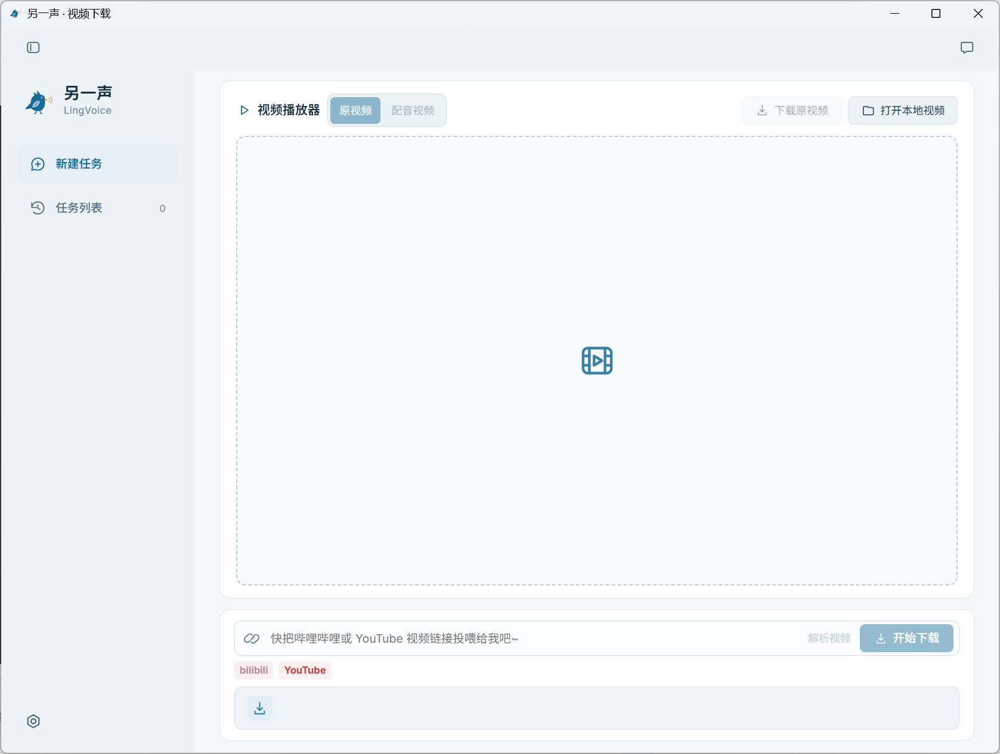

<div align="center">

  

  # 另一声 · LingVoice

  **集 B 站视频解析下载、AI 语音识别、双语字幕翻译与声音克隆配音于一体的桌面工作台**

  <p align="center">
    <a href="#核心特性">核心特性</a> &nbsp;•&nbsp;
    <a href="#快速启动">快速启动</a> &nbsp;•&nbsp;
    <a href="#本地-ai-插件">本地 AI 插件</a> &nbsp;•&nbsp;
    <a href="#项目构建与测试">项目构建与测试</a> &nbsp;•&nbsp;
    <a href="#安全与存储机制">安全与存储机制</a>
  </p>

  <p align="center">
    
    
    
    
  </p>

</div>

> 面向视频创作者与本地工作流的桌面端音视频处理伴侣。专注本地数据掌控、云端/离线灵活扩展与全流程一键协同。

<div align="center">
  <p align="center"><b>☀️ 工作台预览</b></p>
  
</div>

---

## 核心特性

- **B 站视频解析与合并** &mdash; 支持 `BV` / `av` / `b23.tv` 链接及分享文本解析，自动调用 `yt-dlp` 与 `FFmpeg` 无损混流为 MP4 / MKV，支持 Netscape `.txt` Cookie 挂载与断点续传。
- **全流程任务工作台** &mdash; 支持批量导入本地视频或链接，通过任务队列自动串行推进「识别 &rarr; 翻译 &rarr; 配音」，并由内置 `node:sqlite`（WAL 事务模式）持久化保存任务、字幕时间轴与配音记录。
- **高精度 ASR 与双语字幕** &mdash; 本地分段提取 16 kHz 单声道音频并自动还原时间轴（最长支持 6 小时）；支持视频内嵌**双语 / 译文 / 原文 / 关闭**四态实时切换、字号与延迟微调，以及 SRT / VTT 导入与 SRT 导出。
- **人声分离与 AI 配音克隆** &mdash; 支持对白与背景音轨分离（BS-RoFormer），结合阿里百炼 Token Plan TTS（`qwen-audio-3.0-tts-plus`）或本地 `GPT-SoVITS V5` 复刻音色，保音高变速对齐时间轴并重新混音输出 `.mkv`。
- **云端与本地双轨扩展** &mdash; 提供可扩展的 `ProviderRegistry` 适配器架构（兼容 OpenAI、Responses、LibreTranslate 及自定义服务），同时内置独立隔离的本地 Python AI 插件体系，按需切换不锁定厂商。
- **创新双模与双语界面** &mdash; 既可作为独立 Electron 原生桌面端运行，也支持通过 `npm run web` 在浏览器直连 Node 真实后端进行调试；原生内置**简体中文 / English** 实时无刷新切换。

---

## 快速启动

开发环境需要 **Node.js 22.13.0 或更高版本**（依赖内置 `node:sqlite`）。首次解析 B 站视频时会自动从 GitHub Release 下载并校验 `yt-dlp.exe`。

### 1. 桌面客户端开发模式

启动 Vite 热更新与 Electron 主进程：

```powershell
npm install
npm run dev
```

### 2. 浏览器调试模式

启动本地 Node 后端服务与浏览器界面，直接复用真实的下载、识别、翻译、配音与 SQLite 存储能力：

```powershell
npm run web
```

### 3. 生产构建启动或快捷脚本

```powershell
# 编译前后端产物并以生产模式启动
npm start
```

也可直接双击根目录下的 `启动下载器.bat` 快速启动。

---

## 本地 AI 插件

`plugins/` 目录提供了与系统 Python 完全隔离的本地模型运行环境（基于独立 `.venv` 与 `uv` 运行时），均绑定至 `127.0.0.1` 本地回环端口：

| 服务模块 | 默认端口 | 核心模型 | 用途说明 |
| :--- | :--- | :--- | :--- |
| `asr` | `9871` | Qwen3-ASR-1.7B + ForcedAligner-0.6B | 本地语音识别与词级强制对齐 |
| `translation` | `9872` | Gemma 4 E2B (NF4 4-bit) | 本地字幕校对与多语言翻译 |
| `voice-clone` | `9873` | GPT-SoVITS V5 (`v5turbo`) | 本地参考音频零样本音色克隆 |
| `separation` | 按需调用 | BS-RoFormer (`karaoke_bs_roformer`) | 对白与背景伴奏双轨无损分离 |

在项目根目录的 PowerShell 中通过统一管理入口准备与启停服务：

```powershell
# 1. 初始化受校验的运行时并安装各插件独立环境
powershell -NoProfile -ExecutionPolicy Bypass -File .\plugins\plugins.ps1 -Action bootstrap
powershell -NoProfile -ExecutionPolicy Bypass -File .\plugins\plugins.ps1 -Action install

# 2. 下载并校验官方模型权重（支持断点续传）
powershell -NoProfile -ExecutionPolicy Bypass -File .\plugins\plugins.ps1 -Action download

# 3. 检查环境与权重就绪状态 / 启停指定服务（以 translation 为例）
powershell -NoProfile -ExecutionPolicy Bypass -File .\plugins\plugins.ps1 -Action check
powershell -NoProfile -ExecutionPolicy Bypass -File .\plugins\plugins.ps1 -Action start -Service translation
powershell -NoProfile -ExecutionPolicy Bypass -File .\plugins\plugins.ps1 -Action stop -Service translation
```

更多显存调度（8 GB 显存分阶段执行与 `gpu_lease.py` 跨进程互斥）、离线分离参数及接口细节，请参阅 [`plugins/README.md`](plugins/README.md) 与 [`docs/dubbing-local-setup.md`](docs/dubbing-local-setup.md)。

---

## 项目构建与测试

```powershell
# 主进程、共享类型、React 与工具脚本的严格 TypeScript 检查
npm run check

# 运行核心模块离线自动化测试
npm test

# 运行桌面集成测试（自动生成中英文截图至 artifacts/，请先关闭已运行的应用）
npm run test:desktop

# 构建产物并在 release/ 生成 Windows NSIS 安装包
npm run dist
```

安装包输出路径：`release/LingVoice-Setup-${version}.exe`

---

## 安全与存储机制

- **凭据硬件级加密** &mdash; 各服务商 API Key 经 Electron `safeStorage`（Windows DPAPI）加密保存于用户数据目录的 `providers.json`，渲染进程无法直接读取原始密钥或密文。
- **Cookie 仅存内存** &mdash; 导入的 Netscape Cookie 文件路径仅保留在当前会话内存中，不上传至任何第三方服务器或自建遥测服务。
- **纯本地数据闭环** &mdash; 任务、字幕与配置均保存在本地 SQLite 数据库（桌面版位于 `userData/history.sqlite`，Web 版位于 `~/.lingvoice/web/history.sqlite`），不依赖云端账号同步。
- **本地插件通信隔离** &mdash; 本地 AI 服务仅监听 `127.0.0.1`，关键 POST 接口强制校验动态生成的 `Bearer Token` 并拒绝携带跨域 `Origin` 的浏览器请求。
- **原子化媒体产出** &mdash; 音频提取、分离、对齐与混音均在私有暂存区完成，校验通过后通过硬链接原子发布，任务取消或失败绝不残留半成品覆盖原文件。

---

## 免责声明

本项目为第三方开源桌面原型，非哔哩哔哩官方产品，亦不绕过付费、会员、版权、地区限制或数字版权管理（DRM）。请仅对拥有合法版权或已获明确授权的音视频执行下载、识别与声音克隆操作，并遵守相关平台服务条款及模型权重许可协议。

调用远程 ASR、翻译或 TTS（如阿里百炼 Token Plan）接口前请确认服务商计费规则。此外，当前打包配置尚未完成代码签名与随包 FFmpeg 的 GPL 分发合规流程，请勿在未核查授权义务前直接对外公开分发构建产物。
